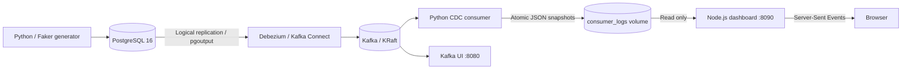

# PostgreSQL CDC with Debezium, Kafka, and a Live Dashboard

A local change data capture (CDC) project that streams PostgreSQL changes through Debezium into Kafka, processes them with a Python consumer, and displays consumed events in a JavaScript dashboard.

The project includes an ecommerce schema, seed data, a synthetic data generator, Kafka UI, and a separate Node.js dashboard. Docker Compose runs the infrastructure and applications; the data generator runs from your terminal.

## Contents

- [Architecture](#architecture)
- [Project structure](#project-structure)
- [Prerequisites](#prerequisites)
- [Quick start](#quick-start)
- [Services and connection settings](#services-and-connection-settings)
- [Database and event format](#database-and-event-format)
- [Data generator](#data-generator)
- [Consumer](#consumer)
- [Dashboard](#dashboard)
- [Connector management](#connector-management)
- [Operations and verification](#operations-and-verification)
- [Troubleshooting](#troubleshooting)
- [Stopping and resetting](#stopping-and-resetting)
- [Limitations and development notes](#limitations-and-development-notes)

## Architecture



Debezium performs an initial snapshot and then reads committed database changes from PostgreSQL's write-ahead log. The consumer subscribes to five ecommerce topics and records counts and recent events. It writes `consumer-state.json` to a shared Docker volume, which the dashboard reads through its API.

The dashboard observes the existing consumer. It does not create another Kafka consumer or take partitions away from it.

## Project structure

```text
.
├── .gitignore
├── README.md
├── docker-compose.yml
├── postgres/
│   ├── init.sql                 # Schema, seeds, triggers, views, publication
│   ├── postgresql.conf          # Logical replication and database settings
│   └── pg_hba.conf              # Connection authentication rules
├── debezium/
│   └── postgres-connector.json  # Kafka Connect connector configuration
├── consumer/
│   ├── consumer.py              # Kafka polling, handlers, terminal statistics
│   ├── telemetry.py             # Snapshot writer for dashboard observers
│   ├── requirements.txt
│   └── Dockerfile
├── dashboard/
│   ├── public/
│   │   ├── index.html           # Dashboard structure and accessible controls
│   │   ├── styles.css           # Responsive dark/light themes and animations
│   │   └── app.js               # SVG charts, filters, inspectors, SSE client
│   ├── test/                   # Metric correctness and probe tests
│   ├── Dockerfile
│   ├── package.json
│   ├── package-lock.json
│   ├── monitor.js               # Read-only PostgreSQL, Connect, and Kafka probes
│   ├── metrics.js               # Throughput, latency, redaction, bounded history
│   └── sever.js                 # Node HTTP/SSE server; spelling is intentional
├── scripts/
│   ├── generate-data.py
│   └── requirements.txt
└── NOTES/
    └── setup.md                 # Earlier setup notes
```

Use the commands in this README from the project root unless a section says otherwise.

## Prerequisites

- Docker Engine or Docker Desktop, running, with Docker Compose v2 (`docker compose`).
- Python and `pip` for the data generator. Python 3.12 is a practical choice matching the consumer image.
- `curl` for connector registration and status checks.
- Available host ports: `5433`, `9092`, `29092`, `8080`, `8083`, and `8090`.
- Internet access for the first Docker image builds and Python dependency installation.

Node.js is supplied by the dashboard container. Local Node.js 22 or later is needed only when running the dashboard outside Docker.

## Quick start

### 1. Start the services

Open a terminal in the directory containing `docker-compose.yml`:

```bash
docker compose config --quiet
docker compose up -d --build
docker compose ps
```

On a fresh PostgreSQL volume, `postgres/init.sql` creates `enterprise_db`'s ecommerce schema and seed records. Wait for PostgreSQL, Kafka, and Debezium to become healthy.

The consumer waits for Kafka and CDC topics. It can start before the connector is registered; no events will arrive until registration succeeds.

### 2. Register the PostgreSQL connector

```bash
curl --fail-with-body -X POST http://localhost:8083/connectors \
  -H 'Accept: application/json' \
  -H 'Content-Type: application/json' \
  --data-binary @debezium/postgres-connector.json
```

Registration is separate from starting Compose. If the connector already exists, inspect its status or use the update command under [Connector management](#connector-management).

```bash
curl -sS http://localhost:8083/connectors/postgres-cdc-connector/status \
  | python3 -m json.tool
```

Both `connector.state` and task `0`'s `state` should be `RUNNING`. The creation response alone is not proof that the task has started.

### 3. Open the interfaces

- [Live CDC dashboard](http://localhost:8090): consumed event counts, filters, and record details.
- [Kafka UI](http://localhost:8080): topics, messages, consumer groups, and connector information.

### 4. Generate changes

```bash
python3 -m venv .venv
source .venv/bin/activate
python -m pip install -r scripts/requirements.txt
python scripts/generate-data.py --port 5433 --interval 2
```

Press **Ctrl+C** to stop. The explicit `--port 5433` is required for the supplied Compose mapping; the script's default is `5432`.

For a one-minute run:

```bash
python scripts/generate-data.py --port 5433 --interval 2 --duration 60
```

Watch for new events in the dashboard and logs:

```bash
docker compose logs -f cdc-consumer
```

## Services and connection settings

| Compose service | Container | Host access | Docker network address |
| --- | --- | --- | --- |
| `postgres` | `cdc-postgres` | `localhost:5433` | `postgres:5432` |
| `kafka` | `cdc-kafka` | `localhost:29092` for local Kafka clients | `kafka:9092` |
| `debezium` | `cdc-debezium` | [localhost:8083](http://localhost:8083) | `debezium:8083` |
| `kafka-ui` | `cdc-kafka-ui` | [localhost:8080](http://localhost:8080) | `kafka-ui:8080` |
| `cdc-consumer` | `cdc-consumer` | No HTTP port | Kafka client on `cdc-network` |
| `dashboard` | `cdc-dashboard` | [localhost:8090](http://localhost:8090) | `dashboard:8090` |

Kafka also maps port `9092`, but its internal listener advertises the Docker hostname `kafka`. Use `localhost:29092` from your host, rather than `localhost:9092`.

The dashboard's published port is bound to `127.0.0.1`. Other published service ports use the broader bindings currently defined in Compose.

### Demo database credentials

| Setting | Value |
| --- | --- |
| Database | `enterprise_db` |
| Schema | `ecommerce` |
| User | `cdc_user` |
| Password | `cdc_password` |
| Publication | `cdc_publication` |
| Replication slot | `debezium_slot` |
| Connector | `postgres-cdc-connector` |

These are checked-in demo credentials. This project currently reads them from Compose, the connector JSON, and the generator's `DB_CONFIG`; creating a `.env` file alone does not override those hardcoded values.

## Database and event format

### Captured tables

| Table | Expected routed topic | Purpose |
| --- | --- | --- |
| `ecommerce.customers` | `cdc.customers` | Customer profiles and loyalty tiers |
| `ecommerce.products` | `cdc.products` | Product catalog and prices |
| `ecommerce.orders` | `cdc.orders` | Orders and lifecycle status |
| `ecommerce.order_items` | `cdc.order_items` | Individual order lines |
| `ecommerce.inventory` | `cdc.inventory` | Stock and replenishment |

Initialization also creates heartbeat, signaling, metrics, and audit tables, helper functions, and dashboard/replication views. They are not all included in the connector's `table.include.list`. The audit table exists, but the installed CDC tracking triggers write to `cdc_metrics`.

Seed data includes 10 products, inventory records for those products, and 5 customers. Orders and order items are created by the generator.

### Event payload

The connector preserves the Debezium envelope because the unwrap transformation is disabled. A simplified update looks like:

```json
{
  "before": { "id": "example-uuid", "tier": "silver" },
  "after": { "id": "example-uuid", "tier": "gold" },
  "source": { "db": "enterprise_db", "schema": "ecommerce", "table": "customers" },
  "op": "u",
  "ts_ms": 1792053853136
}
```

| Operation | Meaning |
| --- | --- |
| `c` | Insert/create |
| `u` | Update |
| `d` | Delete |
| `r` | Initial snapshot read |

A delete can be followed by a null tombstone. The consumer logs and skips tombstones rather than counting them as another data event. The consumer accepts `op` and the flattened `__op` field, but the supplied connector uses `op`.

The connector requests full replica identity for captured ecommerce tables. Check the actual table settings when troubleshooting missing `before` values; snapshot reads have no previous row image.

## Data generator

`scripts/generate-data.py` chooses among six operations:

1. Create a customer.
2. Update a customer tier or spending total.
3. Create an order and its order items in one transaction.
4. Advance an order through `pending → confirmed → processing → shipped → delivered`.
5. Adjust inventory and its available quantity.
6. Adjust a product price by approximately -10% to +15%.

It uses Faker and parameterized SQL, commits successful operations, rolls back database errors, and closes the connection on shutdown. Some attempts do nothing when no eligible rows exist. Its displayed operation count is a count of successful function calls, not Kafka events; one order creation produces several row events.

| Argument | Default | Meaning |
| --- | --- | --- |
| `-i`, `--interval` | `2` | Delay between operation attempts in seconds |
| `-d`, `--duration` | Unlimited | Stop after this many seconds |
| `--host` | `localhost` | PostgreSQL host |
| `--port` | `5432` | PostgreSQL port; pass `5433` for this Compose setup |

The generator does not create the database or schema and does not generate deletes. Initialization belongs to `postgres/init.sql`.

If your terminal is already inside `scripts/`, use:

```bash
python generate-data.py --port 5433 --interval 2
```

## Consumer

The Python consumer uses `confluent-kafka`, table-specific handlers, in-memory event statistics, and Rich terminal tables. The handlers currently log the operation; they do not write to a downstream database.

| Environment variable | Default | Purpose |
| --- | --- | --- |
| `KAFKA_BOOTSTRAP_SERVERS` | `kafka:9092` | Kafka bootstrap address |
| `KAFKA_GROUP_ID` | `cdc-consumer-group` | Kafka consumer group |
| `KAFKA_AUTO_OFFSET_RESET` | `earliest` | Starting offset when no valid committed offset exists |
| `CDC_LOG_FILE` | `/app/logs/consumer.log` | Log file; falls back to `consumer.log` if its directory is missing |
| `CDC_TELEMETRY_FILE` | `/app/logs/consumer-state.json` | Atomic JSON telemetry snapshot |

Compose explicitly sets the bootstrap servers and group. Change or add variables in its `cdc-consumer.environment` section when needed.

### Run the consumer locally

Use Python 3.12 for the pinned consumer dependencies. Stop the Docker consumer first so the local process does not share its partitions:

```bash
docker compose stop cdc-consumer
python -m pip install -r consumer/requirements.txt
mkdir -p logs
KAFKA_BOOTSTRAP_SERVERS=localhost:29092 \
CDC_LOG_FILE=logs/consumer.log \
CDC_TELEMETRY_FILE=logs/consumer-state.json \
python consumer/consumer.py
```

The Docker dashboard reads the Docker volume, so it will not see a local `logs/` file automatically. Use the local dashboard command below for this arrangement.

## Dashboard

All web application code lives under `dashboard/`. The build-free frontend uses native JavaScript, CSS, inline SVG icons/charts, and Server-Sent Events (SSE). The Node backend uses `pg` and `kafkajs` for live read-only infrastructure probes. No frontend framework, CDN, or JavaScript build step is required; the Docker image installs locked backend dependencies with `npm ci`.

Features:

- Animated PostgreSQL → Debezium → Kafka → dashboard topology with clickable diagnostics.
- Persistent dark/light preference, responsive layouts, keyboard-accessible dialogs, and reduced-motion support.
- Total successful events, observed throughput, rolling p95 latency, and actual consumer group lag.
- Interactive throughput/latency charts with up to five minutes of server observations and pointer tooltips.
- Event operation breakdown and per-topic counts, partitions, and committed lag.
- Latest 200 events with topic, operation, relative-time, timestamp, and payload search filters.
- Event drawer with before/after/raw payload tabs, actual source/emission/receipt timestamps, and Kafka partition/offset.
- Pause/resume of the event list while pipeline processing and analytics continue.
- Error observations, live component diagnostics, stale-data states, and automatic SSE reconnection.

The browser receives SSE updates about once per second; infrastructure probes run roughly every five seconds after each probe cycle finishes. The dashboard reads `consumer_logs` with a read-only mount. Its database sessions default to read-only, and Kafka monitoring reads offsets without resetting or committing them. The UI provides no mutation endpoints.

### Measurement definitions

| Metric | Data source and boundary |
| --- | --- |
| Successful events | Events whose table handler completed in the current Python consumer session; tombstones excluded |
| Throughput | Change in successful counts divided by elapsed time between fresh server observations; initially unavailable |
| p95 latency | Source `source.ts_ms` to consumer receipt for retained live events received in the last 60 seconds; snapshot reads, missing timestamps, and negative clock differences excluded |
| Consumer group lag | Sum of partition high watermark minus committed group offset, clamped at zero; unavailable when commits are missing or probes fail |
| PostgreSQL changes | `pg_stat_database` insert/update/delete counters since its statistics reset; database-wide, including internal writes |
| Debezium health | Connector state plus all returned task states from Kafka Connect; healthy requires a running connector and at least one running task |
| Error observations | Processing, deserialization, and Kafka/consumer error observations; not a count of unique rejected records |

Lag can briefly include records already processed but not yet auto-committed. Latency depends on clock agreement and is based on at most the retained 200 events, not every event in a high-volume stream. Missing values display as unavailable, never as simulated values.

Particles animate briefly after received events. They illustrate the pipeline route, **not the exact in-flight location of a record**. The event drawer shows recorded observations instead of inventing a distributed trace. All metrics come from the running pipeline; synthetic ecommerce records generated by the demo are real CDC input, not simulated dashboard traffic.

Counts cover the current consumer session. A dashboard restart retains the latest telemetry snapshot in the volume, but resets its five-minute chart history. A consumer restart resets counts and the event buffer. Filters search retained events only. Pausing the list does not preserve events that later fall out of the 200-event buffer.

### HTTP endpoints

| Endpoint | Response |
| --- | --- |
| `GET /` or `/index.html` | Dashboard page |
| `GET /api/stream` | SSE stream with telemetry, metric history, and infrastructure probes |
| `GET /api/events` | Latest JSON observation, including infrastructure, throughput, and latency |
| `GET /health` | Node server liveness; does not verify upstream health |

The backend keeps database credentials in environment variables, sanitizes infrastructure failures, and redacts credential-like fields in telemetry before sending it to the browser. Business record data still appears in event payloads; the phone-masking limitation below remains relevant.

### Run the dashboard locally

With a local consumer writing `logs/consumer-state.json`, open another terminal:

```bash
cd dashboard
npm ci
PGHOST=localhost PGPORT=5433 PGDATABASE=enterprise_db \
PGUSER=cdc_user PGPASSWORD=cdc_password \
KAFKA_BROKERS=localhost:29092 CONNECT_URL=http://localhost:8083 \
CDC_TELEMETRY_FILE=../logs/consumer-state.json PORT=8090 npm start
```

Stop the Docker dashboard first if it owns port `8090`:

```bash
docker compose stop dashboard
```

`PORT` defaults to `8090`; `CDC_TELEMETRY_FILE` defaults to `/data/consumer-state.json` in the Node server. Its listener binds to all interfaces; Compose limits host exposure to loopback.

Backend monitoring variables are `PGHOST`, `PGPORT`, `PGDATABASE`, `PGUSER`, `PGPASSWORD`, `KAFKA_BROKERS`, `KAFKA_GROUP_ID`, `CONNECT_URL`, and `CONNECTOR_NAME`. Compose supplies these for Docker-network addresses. Use a dedicated restricted monitoring database role for deployments beyond this local demo; the example uses the existing demo user.

Run metric/probe tests and syntax checks locally:

```bash
cd dashboard
npm ci
npm test
npm run check
```

Tests cover missing offsets, large offsets, latency exclusions, throughput/session resets, bounded history, secret redaction, failed probes, and read-only Kafka offset queries. Backend client references: [KafkaJS admin API](https://kafka.js.org/docs/admin) and [node-postgres pool API](https://node-postgres.com/apis/pool).

## Connector management

### Inspect connectors, task status, and topics

```bash
curl -sS http://localhost:8083/connectors
curl -sS http://localhost:8083/connectors/postgres-cdc-connector/status \
  | python3 -m json.tool
docker compose exec kafka kafka-topics --bootstrap-server kafka:9092 --list
```

### Update an existing connector

The update endpoint accepts only the inner `config` object, unlike the creation endpoint:

```bash
python3 -c 'import json; print(json.dumps(json.load(open("debezium/postgres-connector.json"))["config"]))' \
  | curl --fail-with-body -X PUT \
      http://localhost:8083/connectors/postgres-cdc-connector/config \
      -H 'Content-Type: application/json' \
      --data-binary @-
```

### Restart a failed task

After fixing the cause reported in its status trace:

```bash
curl --fail-with-body -X POST \
  http://localhost:8083/connectors/postgres-cdc-connector/tasks/0/restart
```

## Operations and verification

```bash
# Check service state and recent logs.
docker compose ps
docker compose logs --tail 100 postgres debezium cdc-consumer dashboard

# Follow application output.
docker compose logs -f cdc-consumer dashboard

# Check the dashboard server and telemetry.
curl -sS http://localhost:8090/health
curl -sS http://localhost:8090/api/events | python3 -m json.tool

# Open a PostgreSQL shell.
docker compose exec postgres psql -U cdc_user -d enterprise_db

# Inspect row counts and replication status.
docker compose exec postgres psql -U cdc_user -d enterprise_db \
  -c 'SELECT * FROM ecommerce.get_table_counts();'
docker compose exec postgres psql -U cdc_user -d enterprise_db \
  -c 'SELECT * FROM ecommerce.cdc_replication_status;'
```

To verify the pipeline, run the generator and confirm a corresponding event appears in Kafka UI, the consumer logs, and the dashboard. A `RUNNING` connector and task confirm startup, but do not by themselves establish that every record is being delivered.

For static configuration checks without producing data:

```bash
docker compose config --quiet
node --check dashboard/sever.js
python3 -c 'import ast; from pathlib import Path; [ast.parse(p.read_text()) for folder in ("consumer", "scripts") for p in Path(folder).glob("*.py")]'
```

The Node check requires local Node.js. These commands check configuration/syntax; they do not exercise the full pipeline.

## Stopping and resetting

Stop and remove containers and the Compose network while retaining named volumes:

```bash
docker compose down
```

Named volumes retain PostgreSQL data, Kafka data/Connect offsets, and consumer logs/telemetry. Restart with `docker compose up -d`.

For a complete **destructive demo reset**, the following deletes all three volumes, including database rows, Kafka messages, connector configuration/offsets, and telemetry:

```bash
docker compose down --volumes
```

Use this only when you intend to discard the local demo data. Start the services again and register the connector again afterward.

